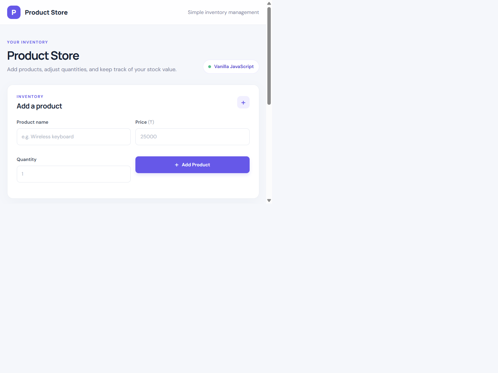

# DOM Store Management

A product inventory manager built with HTML5, CSS3, and vanilla JavaScript. Products are kept in the `Store` class and rendered dynamically using the native DOM API.

## How to open

Open `index.html` directly in a web browser, or open the project folder in VS Code and use the Live Server extension.

## What was implemented

The `submit` event validates the product name, price, and quantity, then adds valid products to the store without reloading the page. The `click` event handles product actions such as deleting a product and increasing or decreasing its quantity. Event delegation lets a single click listener on the product list handle buttons for every product, including products added later. `DOMContentLoaded` runs the initial setup, creates sample products, and renders the first view. The live total recalculates the inventory value after every change without a page reload.

## Screenshot

## AI Tools

ChatGPT was used to assist with code structure, debugging, and explanation.
